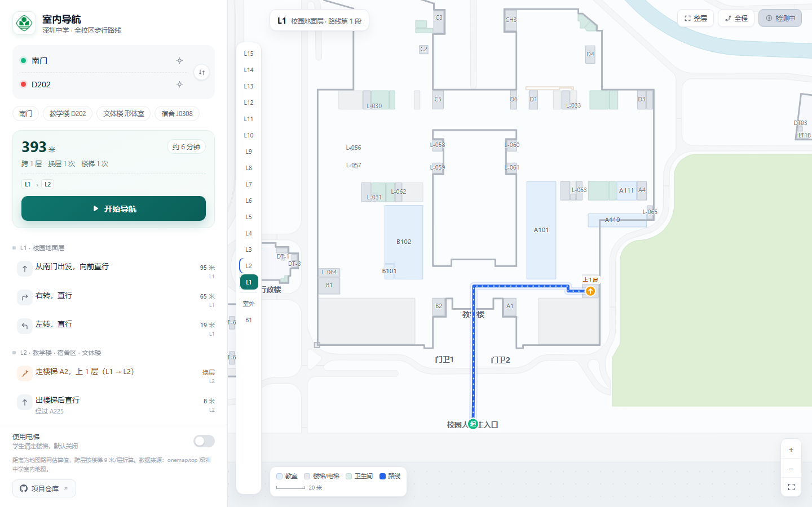
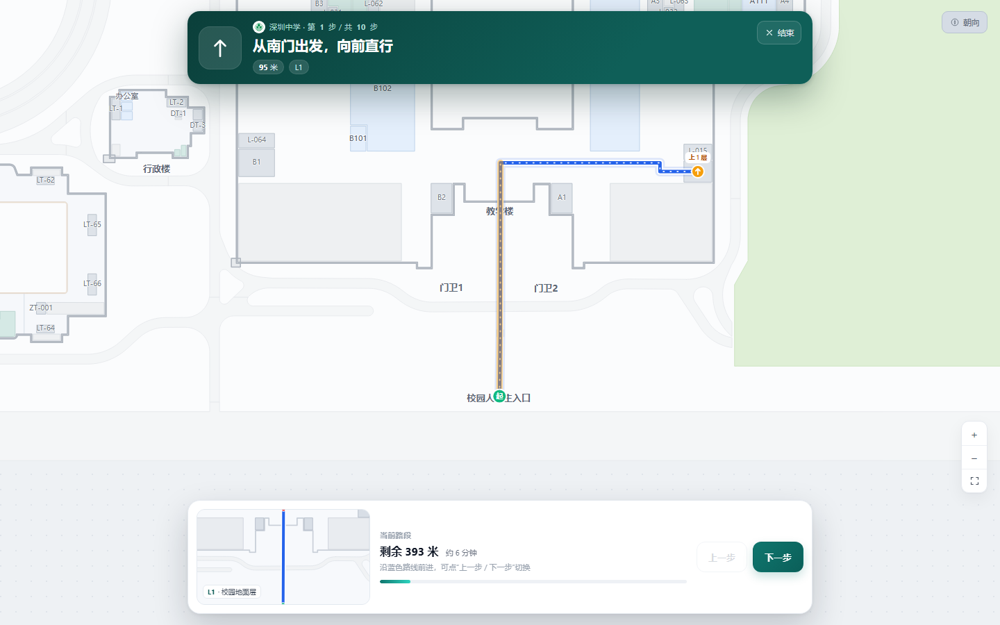

<div align="center">

# 深圳中学室内导航 · SMS Navigator

**单文件、纯离线的校园室内导航应用** —— 搜索教室或班级，按楼层给出分步步行指引，手机上支持指南针朝向旋转。

[](LICENSE)
[](https://anat0le7204.github.io/SMS_Navigator/)
[](#快速开始)
[](#为什么是单文件)
[](CONTRIBUTING.md)

[在线体验](https://anat0le7204.github.io/SMS_Navigator/) · [快速开始](#快速开始) · [使用说明](#使用说明) · [开发](#开发与构建) · [文档](#文档) · [反馈问题](https://github.com/Anat0le7204/SMS_Navigator/issues) · [变更记录](docs/CHANGELOG.md)

</div>



<details>
<summary>更多界面截图（导航模式 / 移动端）</summary>

| 导航模式 | 移动端 |
|---|---|
|  |  |

</details>

## 目录

- [功能特性](#功能特性)
- [快速开始](#快速开始)
- [使用说明](#使用说明)
- [环境与兼容](#环境与兼容)
- [开发与构建](#开发与构建)
- [项目结构](#项目结构)
- [文档](#文档)
- [常见问题](#常见问题)
- [数据来源与限制](#数据来源与限制)
- [贡献](#贡献)
- [许可证与致谢](#许可证与致谢)

## 功能特性

- 🗺️ **官方地图数据** —— 基于深圳中学官方室内地图（onemap.top）的 19 层矢量平面图，6697 个路网节点、1874 个地点。
- 🔍 **教室与班级直达** —— 输入教室号（`D202`）、班级（`高一(1)班` / `高一1班`）或功能室名称即可定位；每学年房间变动只需修改 `data/room.json`。
- 🚶 **分步步行指引** —— Dijkstra 最短路 + 转角识别，每步给出方向、距离、所在楼层，换层单独成步（“走楼梯 A2，上 1 层”）。
- 🧭 **指南针朝向旋转** —— 导航模式下地图随设备朝向旋转，文字与标记保持正立；不支持的设备给出明确提示。
- 📱 **移动端适配** —— 双指捏合缩放、单指拖拽、窄屏卡片布局，导航模式为上下卡片式大指令。
- 📴 **离线单文件** —— 数据、样式、脚本、校徽全部内联，约 1.7 MB，零网络请求，拷贝即用。
- 🏫 **学生友好的楼层策略** —— 默认不使用教学楼电梯（学生走楼梯），可切换「使用教学楼电梯」（教职工 / 访客）；宿舍、行政楼、文体楼等其他楼栋电梯不受该开关限制。

## 快速开始

### 方式一：在线体验

打开 GitHub Pages 部署站点（无需安装任何东西）：

**https://anat0le7204.github.io/SMS_Navigator/**

### 方式二：直接打开单文件

```bash
git clone https://github.com/Anat0le7204/SMS_Navigator.git
# 双击根目录的 index.html 即可使用
```

`index.html` 是构建产物，内联了全部资源，**不依赖网络与本地服务器**。也可以把它拷到 U 盘或手机，用任意浏览器打开。

### 方式三：部署到自己的 GitHub Pages

仓库根目录的 `index.html` 即站点入口。在仓库 **Settings → Pages** 中选择 `Deploy from a branch` → 分支 `main` → 目录 `/ (root)`，无需构建步骤。

## 使用说明

### 搜索与选点

1. 在左侧面板输入**起点 / 终点**：支持教室号、房间名、班级名、校门（如「南门」「东门」）。
2. 输入班级时忽略空格与括号：`高一(1)班` 与 `高一1班` 等价，结果显示「班级名 · 教室号」。
3. 也可以点击地图上的房间直接设为起终点，或使用快捷地点（教学楼 / 文体楼 / 宿舍等）。
4. 点击 **开始导航** 进入全屏导航模式：顶部大指令条 + 底部当前路段缩略图，逐步切换。

### 键盘快捷键

| 按键 | 作用 |
|---|---|
| `↑` / `↓` | 搜索建议上下选择 |
| `Enter` | 选中建议 |
| `Esc` | 关闭搜索建议 / 退出导航 |
| `←` / `→` | 导航模式下切换上一步 / 下一步 |

### 路线策略

- **距离为路网估算值**：坐标按 1 单位 ≈ 0.1 m 折算，跨层按楼梯 9 m/层、电梯 6 m/层当量计算。
- 默认**不使用教学楼电梯**（只走楼梯）；打开「使用教学楼电梯」开关后才会把教学楼电梯纳入寻路，其他楼栋电梯始终可用。

## 环境与兼容

| 项目 | 说明 |
|---|---|
| 浏览器 | Chrome / Edge / Safari / Firefox 等现代浏览器 |
| 运行方式 | 纯静态，离线可用（`file://` 或任意静态服务器） |
| 移动端 | 支持触摸拖拽、双指缩放；窄屏自适应 |
| 指南针 | 需要 HTTPS 或 localhost + 设备方向传感器；iOS 首次使用时点击开关授权 |
| 依赖 | 无（零 npm 包、零构建工具链，构建脚本仅用 Python 标准库） |

## 开发与构建

源码是多文件的（`src/`），通过本地 HTTP 服务预览：

```bash
# 项目根目录
python -m http.server 8000
# 打开 http://localhost:8000/src/
```

修改 `src/` 后刷新即可。重新打包单文件：

```bash
python scripts/build.py     # 输出根目录 index.html
```

数据与目录相关：

```bash
python scripts/build_data.py   # 从 onemap.top 重新抽取地图数据
python scripts/check_rooms.py  # 校验 data/room.json（字段/分类/可定位性）
```

开发调试参数（追加到 URL）：`?compass=sim&heading=90`（模拟朝向）、`?nav=1`（直接进入导航）、`?perf=1`（旋转性能探针）。详见 [docs/BUILD.md](docs/BUILD.md)。

## 项目结构

```
.
├─ index.html                 # 构建产物：单文件离线应用（可直接双击）
├─ src/                       # 多文件源码（开发时使用）
│  ├─ index.html              # 开发入口，按顺序引用样式与脚本
│  ├─ styles/                 # base / panel / map / navigation
│  ├─ js/                     # 00-data / 05-rooms / 10-floorplan … 70-app
│  └─ assets/badge.png        # 深圳中学校徽（透明底）
├─ scripts/
│  ├─ build.py                # 打包脚本：内联 CSS/JS/校徽/数据/房间目录
│  ├─ build_data.py           # 从 onemap.top 抽取地图数据（含楼层统一编码）
│  └─ check_rooms.py          # 房间目录校验
├─ data/
│  ├─ room.json               # 房间目录：编号 / 名称 / 分类（每学年改动只改这里）
│  ├─ map-data.json           # 结构化离线地图数据
│  └─ *.js                    # 开发用包装（build.py 生成，不入库）
├─ tools/                     # 地图数据可视化编辑器（map-editor.html + 文档）
└─ docs/                      # 文档与截图
```

## 文档

| 文档 | 内容 |
|---|---|
| [docs/ARCHITECTURE.md](docs/ARCHITECTURE.md) | 架构说明：模块划分、数据流、路径模型、导航状态机 |
| [docs/DATA.md](docs/DATA.md) | 数据说明：地图来源、楼层编码、路网与跨层推断、房间目录格式 |
| [docs/COMPASS.md](docs/COMPASS.md) | 指南针与朝向旋转：检测/授权、旋转实现、性能修复与调试 |
| [docs/BUILD.md](docs/BUILD.md) | 构建与开发：预览、打包、调试参数、新增模块约定 |
| [docs/CHANGELOG.md](docs/CHANGELOG.md) | 变更记录（语义化版本） |
| [CONTRIBUTING.md](CONTRIBUTING.md) | 贡献指南与文档规范 |
| [tools/使用手册.md](tools/使用手册.md) | 地图数据编辑器使用手册 |

## 常见问题

**Q：指南针按钮是灰色的？**  
设备不支持方向传感器，或页面不在 HTTPS / localhost 下（浏览器安全策略）。iOS 需在点击开关时授予方向权限。详见 [docs/COMPASS.md](docs/COMPASS.md)。

**Q：每年班级 / 教室变动了怎么办？**  
只改 `data/room.json`（房间编号 → 名称 → 分类），然后运行 `python scripts/check_rooms.py` 校验、`python scripts/build.py` 重新打包。业务代码无需改动。

**Q：某房间搜得到但无法规划路线？**  
该房间在 `room.json` 有登记、但官方地图数据里没有对应标注点，界面会提示「暂无地图位置」。属于已知数据缺口（详见 [docs/DATA.md](docs/DATA.md) 第 7 节）。

**Q：为什么不拆成网站而是单文件？**  
校内使用场景大量是离线拷贝、双击打开。单文件避免了静态服务器、跨域、资源路径等问题，且构建只做“内联”不改运行时行为。见 [docs/ARCHITECTURE.md](docs/ARCHITECTURE.md) 第 8 节。

**Q：导航中地图旋转卡顿或闪？**  
已在 v2.2.1 修复（滤镜离屏表面重建导致）。如仍遇到，可用 `?perf=1` 探针测量并附数据提 [Issue](https://github.com/Anat0le7204/SMS_Navigator/issues)。

## 数据来源与限制

- 地图数据来自 `https://www.onemap.top/szzxtest/` 的公开接口，仅用于校内导航演示。
- 坐标为地图单位（1 单位 ≈ 0.1 m）；楼层高度字段缺失，跨层按楼梯 9 m/层、电梯 6 m/层折算。
- 原始路网没有显式跨层边，垂直连接由同名楼梯/电梯 + 相邻楼层 + 坐标匹配推断；室外校门到 L1 为合成边；J 栋入口为补丁边。详见 [docs/DATA.md](docs/DATA.md)。
- 房间以编号为主；名称与分类由 `data/room.json` 补充，未登记的房间仍可按编号搜索。
- 班级名称、无障碍信息、电梯运行时间不在数据中。

## 贡献

欢迎提交 Issue 与 Pull Request —— 修 bug、补房间数据、改进指引文案都算贡献。动手前请阅读 [CONTRIBUTING.md](CONTRIBUTING.md)（含文档规范与本地开发约定）。

## 许可证与致谢

- 本项目以 [GNU General Public License v3.0](LICENSE) 开源。
- 地图数据：深圳中学室内地图（onemap.top），仅用于校内导航演示。
- 校徽：深圳中学官网“校徽校旗”页面（shenzhong.net），仅作校内识别使用。
- 本项目与学校官方无隶属关系，地图与导航结果仅供参考。
